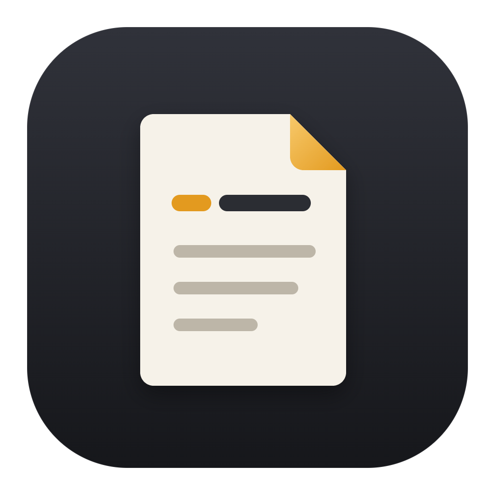
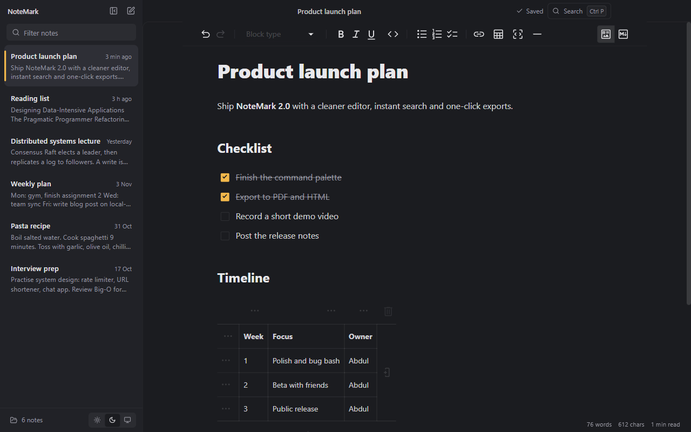
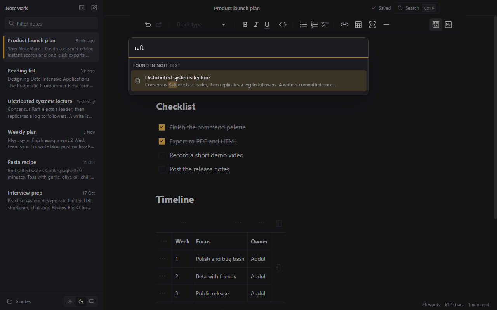
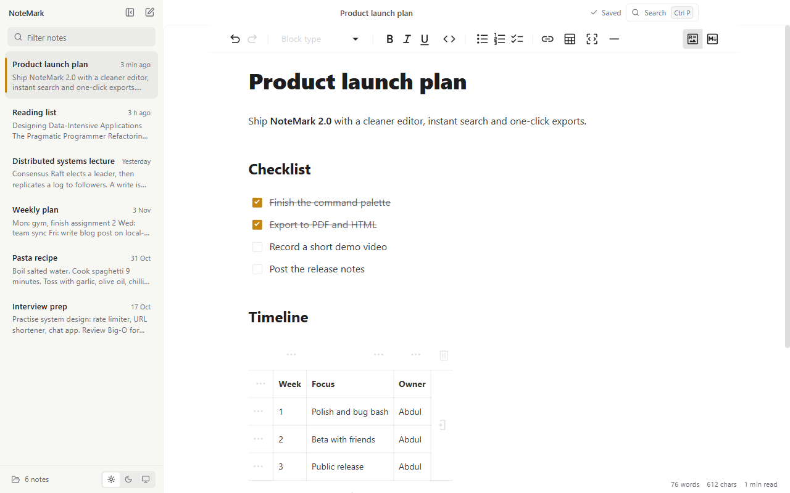
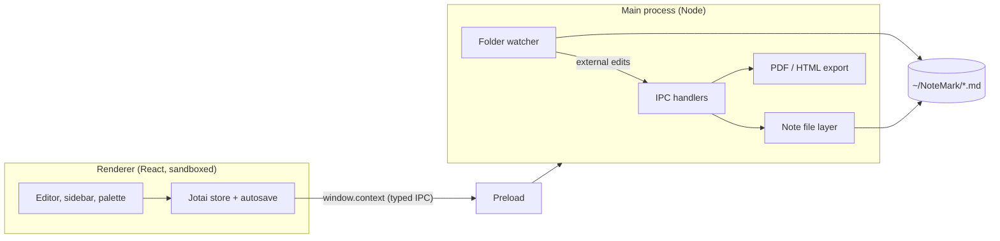

<div align="center">



# NoteMark: A Fast, Local-First Markdown Notes App for Desktop

**Write in Markdown, keep your notes as plain `.md` files, and find anything in a keystroke.**
A free, open-source note-taking app for Windows, macOS and Linux, built with Electron, React and TypeScript.

[](https://github.com/AbdulDevHub/NoteMark/actions/workflows/ci.yml)
[](https://github.com/AbdulDevHub/NoteMark/releases)
[](LICENSE)


[Download](#download) · [Features](#features) · [Shortcuts](#keyboard-shortcuts) · [Development](#development) · [Roadmap](#roadmap)



</div>

## Project Overview

NoteMark is a desktop notebook for people who like Markdown but don't want their notes locked inside an app. Each note is a normal `.md` file in a folder on your computer (`~/NoteMark` by default). You get a clean editor that shows formatting as you type, a sidebar of your notes, and a command palette that searches every note at once. Because the files are plain text, you can also open them in VS Code, sync them with Dropbox or OneDrive, or keep them in Git, and NoteMark notices changes made by those tools.

It started as a small Electron + React learning project and has grown into a complete app. The 2.0 rewrite added a safer file layer, autosave that can't write into the wrong note, search, export, theming, and automated tests.

## Features

- **Rich Markdown editor**: headings, bold/italic/underline, lists, checklists, tables, links, images, quotes, horizontal rules and code blocks with syntax highlighting. Toggle to raw **source mode** whenever you want.
- **Your notes stay yours**: every note is a plain `.md` file. No database, no account, no cloud. Pick any folder (a synced one works well).
- **Command palette** (`Ctrl/⌘ + P`): jump to a note, search inside all notes with highlighted snippets, or run any command.
- **Autosave**: changes are written shortly after you stop typing and when you switch notes, with a saved/saving indicator.
- **Quick capture**: `Ctrl/⌘ + N` creates a note instantly; type its name and press Enter. Click the title (or press `F2`) to rename.
- **Export to PDF or HTML**, from the palette or by right-clicking a note.
- **Live folder sync**: edits made outside NoteMark (another editor, Git, a sync client) show up automatically.
- **Light, dark or system theme**, a custom title bar, and a distraction-free **focus mode**.
- **Sidebar filter**, note previews, relative edit times, word count and reading time.
- **Safe by design**: deleted notes go to your system trash, note titles are validated so nothing is written outside your notes folder, and the window is sandboxed.

<table>
  <tr>
    <td></td>
    <td></td>
  </tr>
  <tr>
    <td align="center">Search every note from the command palette</td>
    <td align="center">Light theme</td>
  </tr>
</table>

## Download

Installers for Windows (`.exe`), macOS (`.dmg`) and Linux (`.AppImage`, `.deb`) are attached to each [GitHub Release](https://github.com/AbdulDevHub/NoteMark/releases). The builds are not code-signed yet, so:

- **Windows**: if SmartScreen appears, choose _More info → Run anyway_.
- **macOS**: right-click the app and choose _Open_ the first time.
- **Linux**: make the AppImage executable (`chmod +x NoteMark-*.AppImage`) or install the `.deb`.

You can also [build it yourself](#development) in a couple of minutes.

## Keyboard Shortcuts

| Shortcut             | Action                                     |
| -------------------- | ------------------------------------------ |
| `Ctrl/⌘ + N`         | New note                                   |
| `Ctrl/⌘ + P`         | Command palette: search notes and commands |
| `F2`                 | Rename the open note                       |
| `Ctrl/⌘ + S`         | Save now (autosave also runs on its own)   |
| `Ctrl/⌘ + \`         | Show or hide the sidebar                   |
| `Ctrl/⌘ + Shift + F` | Focus mode (`Esc` to leave)                |
| `Ctrl/⌘ + K`         | Insert a link (while editing)              |

Right-click any note in the sidebar to rename, export, show it in its folder, or delete it.

## How It Works



- The renderer never touches the file system. It calls a small typed API (`window.context`) that the preload script exposes, and every call is validated in the main process.
- Note titles are file names, so they are checked against the rules of all three operating systems before any file is read or written.
- Autosave is debounced per note and runs saves one at a time, so a slow save can never overwrite newer text.

## Development

Requires Node.js 22.12 or newer.

```bash
git clone https://github.com/AbdulDevHub/NoteMark.git
cd NoteMark
npm install
npm run dev          # start the app with hot reload
```

| Command             | What it does                                       |
| ------------------- | -------------------------------------------------- |
| `npm run verify`    | Typecheck, lint and run unit tests (what CI runs)  |
| `npm test`          | Unit tests with Vitest                             |
| `npm run test:e2e`  | Build, then drive the real app with Playwright     |
| `npm run build:win` | Windows installer (`build:mac`, `build:linux` too) |

Set `NOTEMARK_NOTES_DIR` to point the app at a different notes folder while developing, so you don't touch your real notes.

**Tech stack:** Electron 45, electron-vite, React 18, TypeScript, Jotai, MDXEditor (Lexical), cmdk, Sonner, Tailwind CSS, marked, Vitest and Playwright.

## Roadmap

- Folders, tags and pinned notes
- Images stored next to your notes
- Automatic updates and signed installers
- Backlinks between notes

Have an idea? [Open an issue](https://github.com/AbdulDevHub/NoteMark/issues/new/choose).

## Contributing

Bug reports and pull requests are welcome. See [CONTRIBUTING.md](CONTRIBUTING.md) for setup and guidelines.

## License

NoteMark is released under the [MIT License](LICENSE).
